# AI 協作處理 Excel 資料：成績登錄表範例

---

## 階段 0：準備與情境說明

### 步驟 1　原始成績表

這是尚未完成的成績登錄表，黃色格子是待填欄位。

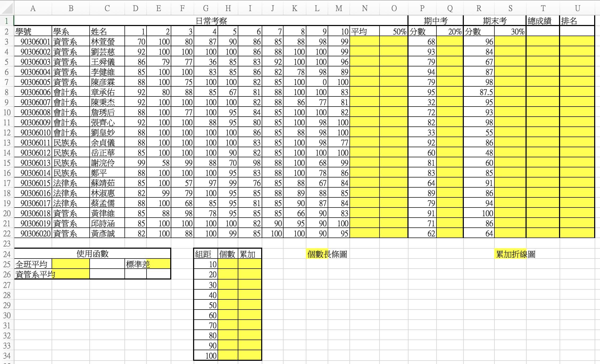

### 步驟 2　向 AI 說明情境

第一次對話不提需求，先**設定 AI 的角色與工作方式**，並**附上表格讓它先讀懂**。

**Prompt**

```text
你是一個Excel資料處理助手，負責協助及引導我完成Excel表格欄位填寫，我會依照順序讓你一步一步幫助我讓這份表格更完整。
附件是一份成績登錄的excel，每個row是一名學生的成績資料，columns則是學號、學系、姓名、成績資料。
你先閱讀這份表格，我後續會提出我的需求。
```

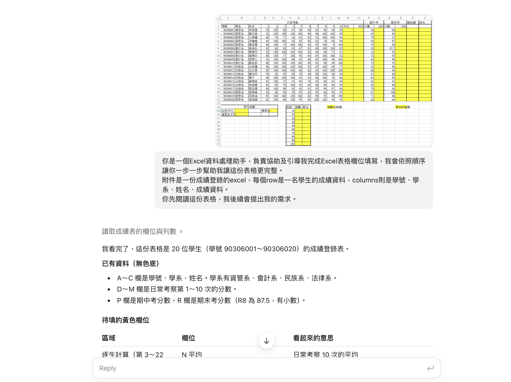

> **檢查重點**：AI 回覆的欄位與列數是否正確（20 位學生、哪些欄是日常、期中、期末、哪些是待填的黃色欄位）。如果它理解錯了，現在就糾正，後面才不會一路錯下去。

---

## 階段 1：日常成績平均與權重（N、O 欄）

### 步驟 3　向 AI 提問

**Prompt**

```text
首先，我要完成col N和col O。col N是學生的日常成績平均、col O是日常成績佔總成績的權重（50%）。
先給我N3和O3要填入的function，讓我能夠複製貼上並往下拖曳完成整個column。
```

**AI 給的公式**

```excel
N3：=AVERAGE(D3:M3)
O3：=N3*0.5
```

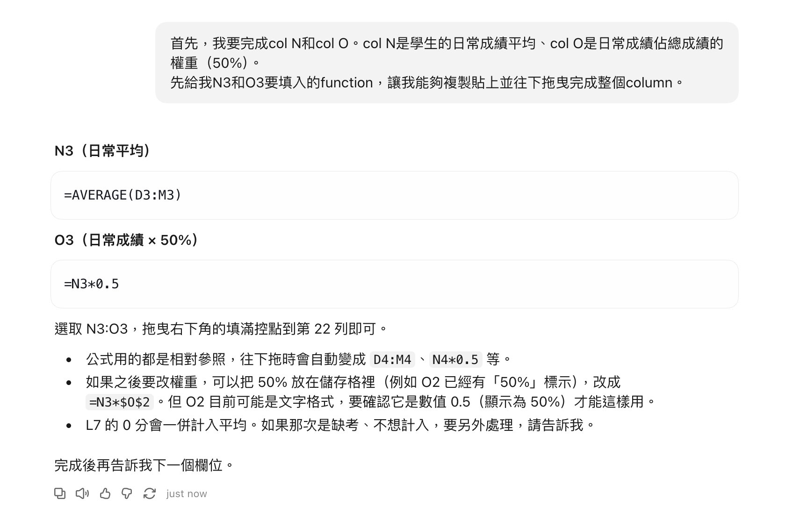

> **小提醒**：prompt 裡要講清楚「貼在第一格，再往下拖曳」，AI 才會用相對參照寫公式。

### 步驟 4　貼上 N3 公式

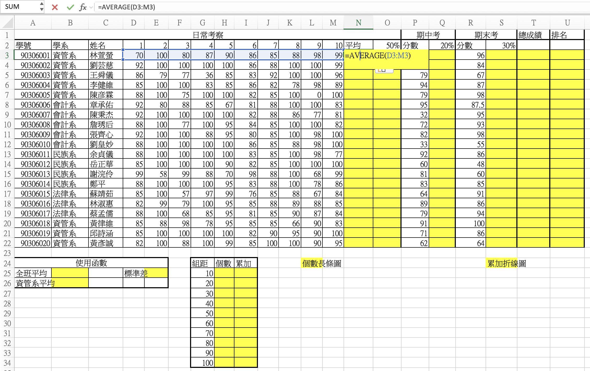

### 步驟 5　N 欄向下填滿

選取 N3，拖曳右下角的填滿控點到第 22 列。

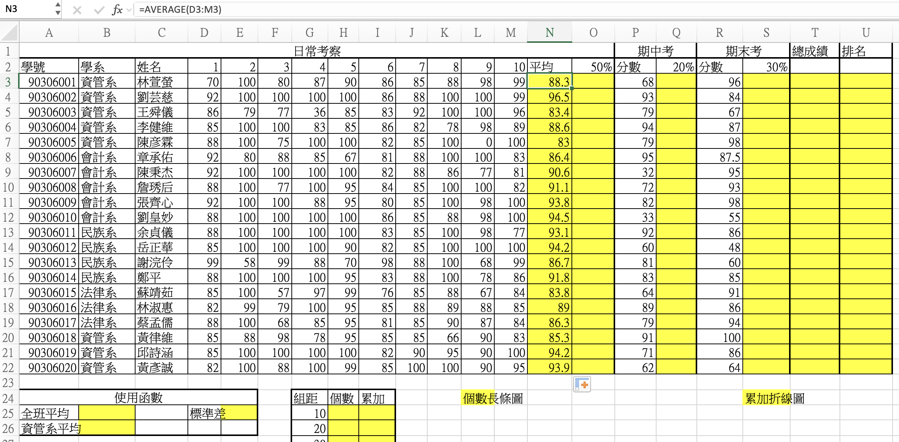

### 步驟 6　貼上 O3 公式

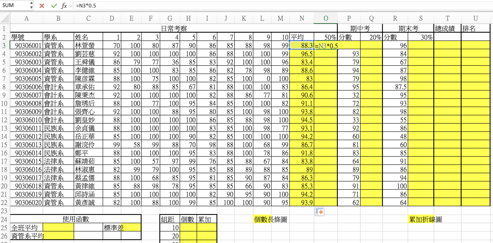

### 步驟 7　O 欄向下填滿

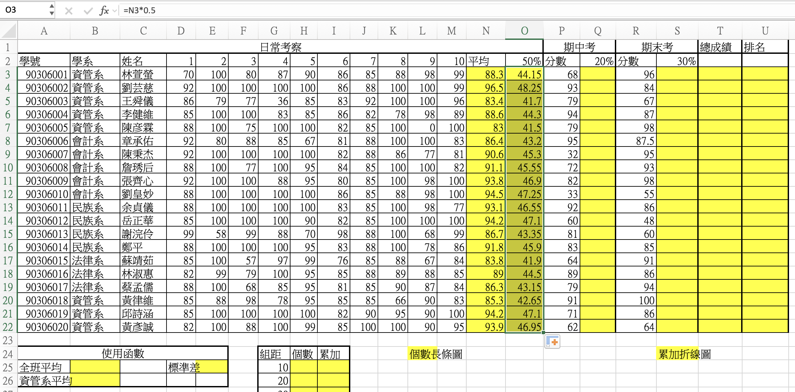

---

## 階段 2：期中、期末加權與總成績（Q、S、T 欄）

### 步驟 8　補上期中、期末加權欄（Q、S）

期中成績要乘 20%、期末成績要乘 30%，才能在 T 欄加總。

```excel
Q3：=P3*0.2
S3：=R3*0.3
```

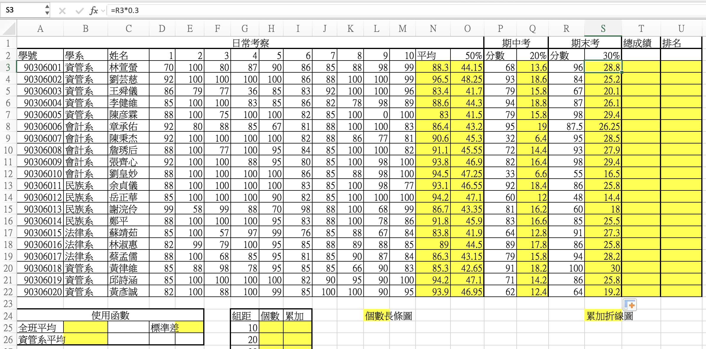


### 步驟 9　向 AI 提問：總成績

**Prompt**

```text
接著我要完成col T的總成績，總成績是日常成績、期中考、期末考的加權平均，給我T3要填入的function，讓我能夠複製貼上並往下拖曳完成整個column。
```

**AI 給的公式**

```excel
=O3+Q3+S3
```

AI 同時提供另一種寫法 `=O3+Q3*0.2+S3*0.3`（在 Q、S 欄還沒填公式時使用），結果相同。本範例已經先填好 Q、S，所以用上面那個。

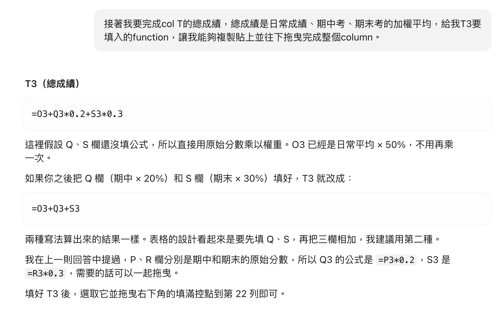

### 步驟 10　貼上 T3 公式

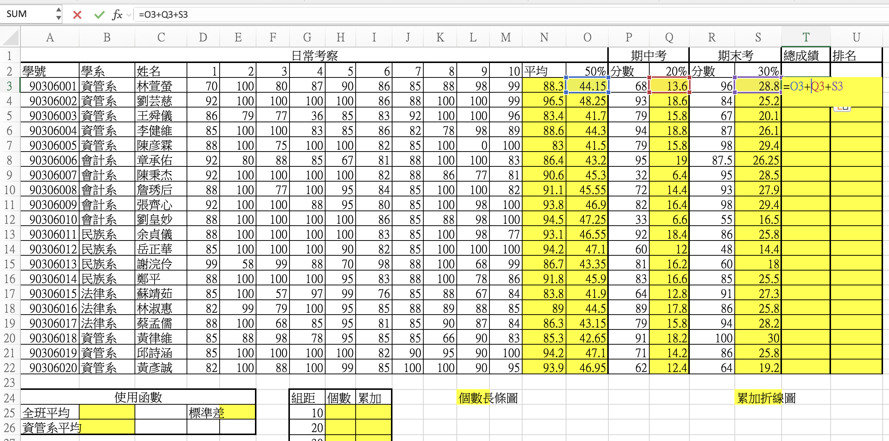

### 步驟 11　T 欄向下填滿

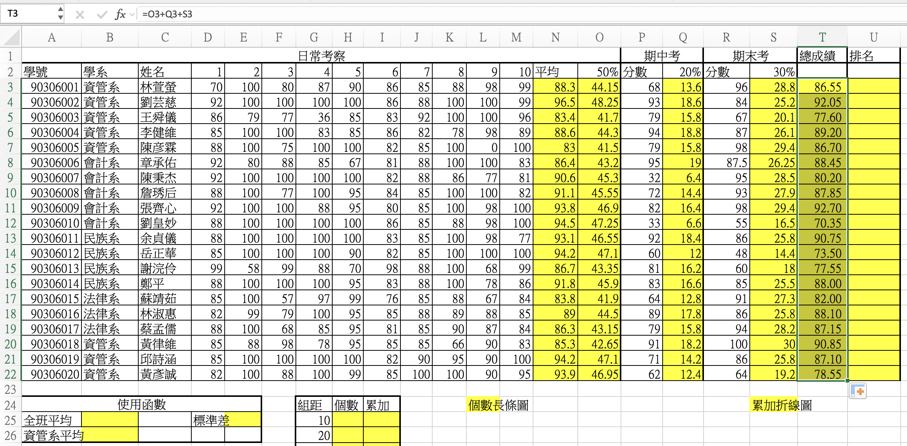

> **驗算**：任選一列手算。例如第 3 列：44.15 + 13.6 + 28.8 = 86.55。

---

## 階段 3：排名（U 欄）

### 步驟 12　向 AI 提問：排名

**Prompt**

```text
我填好總成績了，接著我要完成col U的排名，需要依照學生的總成績進行排名，給我U3要填入的function，讓我能夠複製貼上並往下拖曳完成整個column。
```

**AI 給的公式**

```excel
=RANK(T3,$T$3:$T$22,0)
```

- 最後的 `0` 代表由高到低排名（最高分是第 1 名）。
- `$T$3:$T$22` 使用**絕對參照**（加 `$`），往下拖曳時範圍才不會跟著移動。
- 同分會並列同一名次，下一個名次會跳號。新版 Excel 也可用 `RANK.EQ`，結果相同。

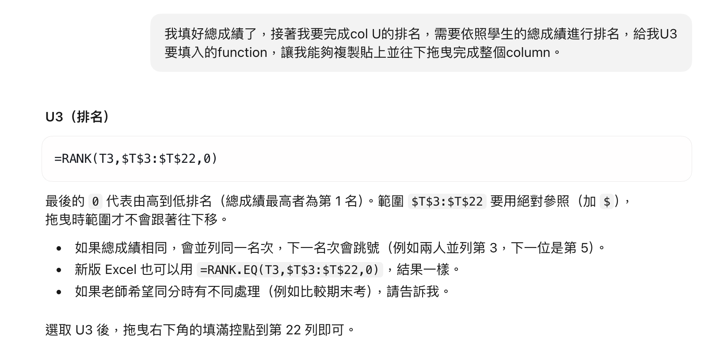

### 步驟 13　貼上 U3 公式

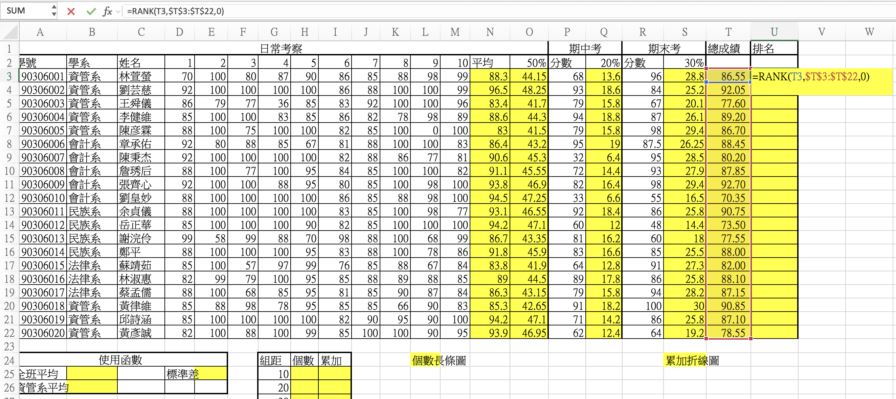

### 步驟 14　U 欄向下填滿

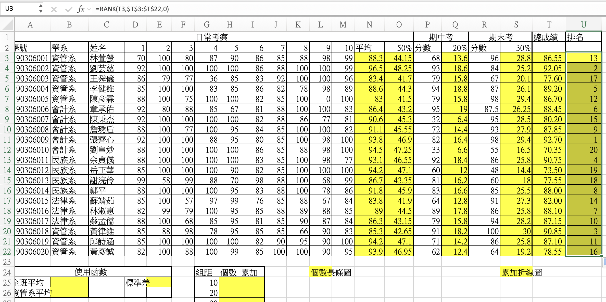

> **驗算**：總成績最高的是第 1 名，最低的是第 20 名；沒有同分時，名次應該是 1～20 不重複。

---

## 階段 4：全班平均、標準差、資管系平均（B25、F25、B26）

### 步驟 15　向 AI 提問：全班平均與標準差

**Prompt**

```text
上方的成績登錄表格已經都完成了，再來要填B25和E25的全班平均及標準差，給我能夠直接複製貼上的function
```

**AI 給的公式**

```excel
B25（全班平均）：=AVERAGE(T3:T22)
標準差：=STDEV.P(T3:T22)
```

- 這 20 人就是整個班級，所以用**母體標準差** `STDEV.P`。如果是樣本標準差，改用 `STDEV.S`。

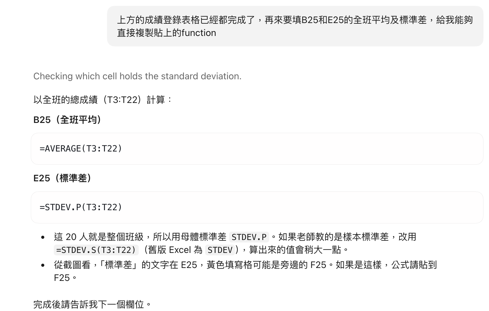


### 步驟 16　貼上公式，完成 B25 與標準差

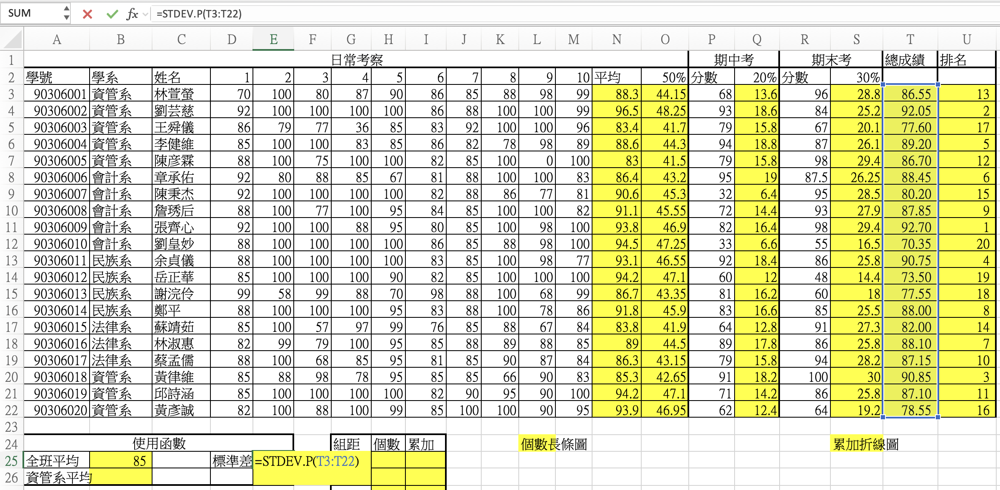

### 步驟 17　向 AI 提問：資管系平均

這一格要「先篩選學系、再算平均」，需要條件式函數。

**Prompt**

```text
接下來要填B26的資管系平均，這一格需要從上方表格中找出學系是「資管系」的學生，並算出總成績的平均，給我能夠直接複製貼上的function。
```

**AI 給的公式**

```excel
=AVERAGEIF(B3:B22,"資管系",T3:T22)
```

意思：在 B3:B22 找出學系為「資管系」的列，再對同一列的 T 欄總成績取平均。

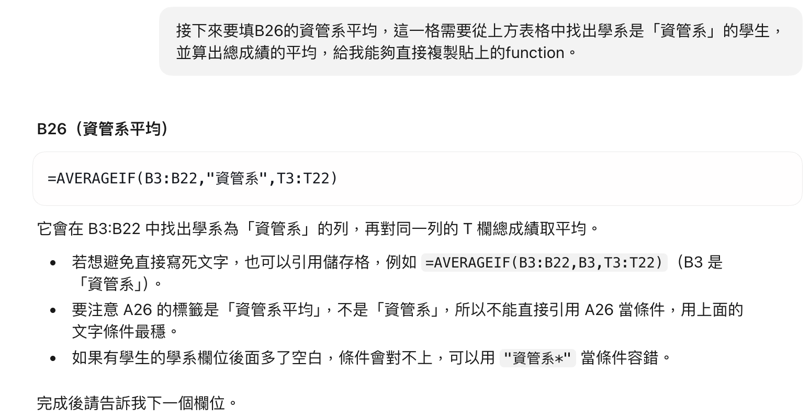

### 步驟 18　貼上 B26 公式

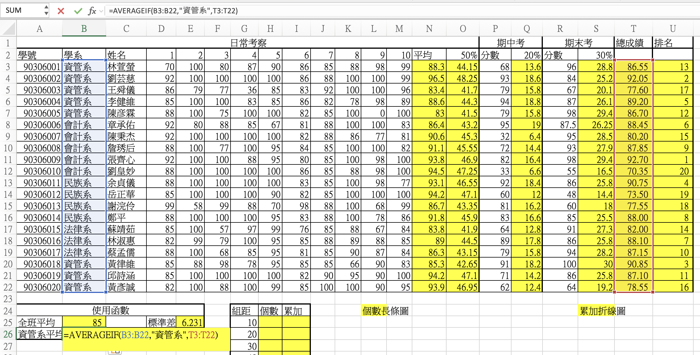

> **驗算**：資管系平均應該落在總成績的合理範圍內，也可以自己挑出資管系學生手算確認。

---

## 階段 5：各組距個數（H 欄）

### 步驟 19　向 AI 提問：各組距個數

**Prompt**

```text
再來我要填H25開始的總成績各組距個數，組距從10到100，以10為一單位，並且各組距是採小於等於的原則。給我能夠直接複製貼上的function。
```

**AI 給的公式**

```excel
H25：=COUNTIFS($T$3:$T$22,"<="&G25,$T$3:$T$22,">"&(G25-10))
```

貼到 H25 後往下拖曳到 H34。每一格計算「總成績 ≤ 該組距，且 > 該組距 − 10」的人數。例如組距 60 算的是 50 < 分數 ≤ 60。

AI 同時提供另一種寫法 `FREQUENCY`：

```excel
=FREQUENCY(T3:T22,G25:G34)
```

**追問 Prompt**（使用 FREQUENCY 時發現結果多出一格）

```text
為什麼會多出超過100的狀況
```

AI 回答：`FREQUENCY` 的設計是結果永遠比組距多一格，最後一格放「大於最後一個組距」的資料個數。成績滿分 100，所以那格一定是 0。

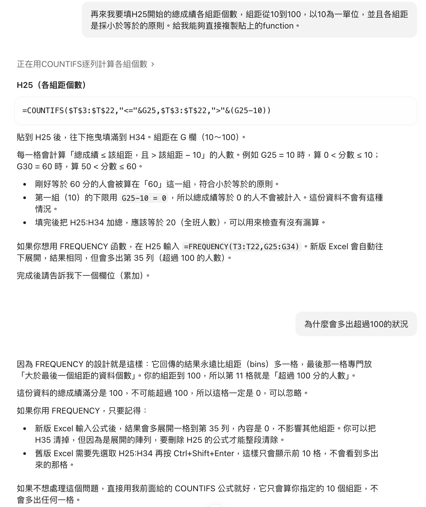

> **示範重點**：看到不懂的結果就追問。如範例中 `FREQUENCY` 的特性，並根據回覆自行修正。

### 步驟 20　貼上公式，完成 H 欄

本範例截圖實際使用的是 `FREQUENCY`，把組距範圍設為 `G25:G33`（10～90）：

```excel
=FREQUENCY(T3:T22,G25:G33)
```

結果的最後一格代表「大於 90 分的人數」，因為成績不會超過 100，剛好就是「91～100」這一組，填入 H34。這樣就不會多出第 35 列。

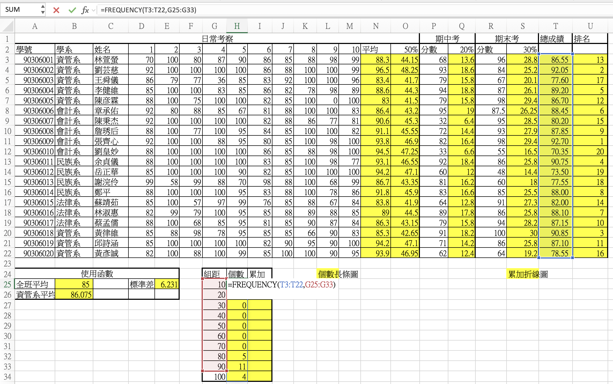

> **驗算**：H25:H34 加總應該等於全班人數 20。

---

## 階段 6：累加次數（I 欄）

### 步驟 21　向 AI 提問：累加次數

**Prompt**

```text
我已經填好H25開始的總成績個數，然後我要填I25開始的總成績組距累加次數，給我能夠直接複製貼上的function。從組距10開始向上累加，計算H25開始的個數加總。
```

**AI 給的公式**

```excel
I25：=SUM($H$25:H25)
```

貼到 I25 後往下拖曳到 I34。起點 `$H$25` 固定（有 `$`），終點 `H25` 隨列數往下移，所以 I26 是 `SUM($H$25:H26)`，每一列都是從組距 10 累加到目前這一列。

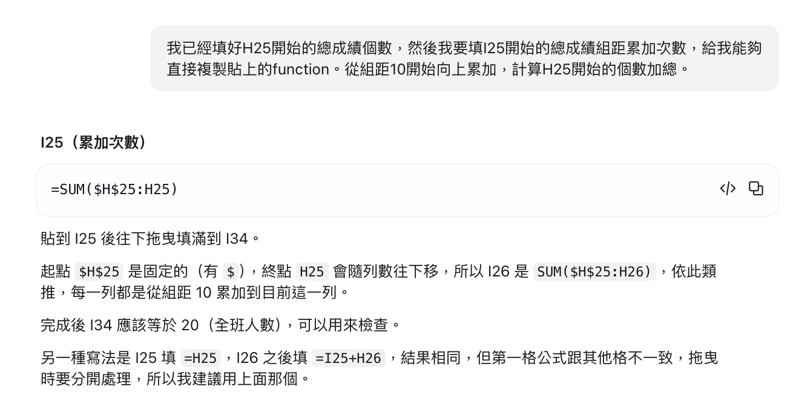

### 步驟 22　貼上 I25 公式

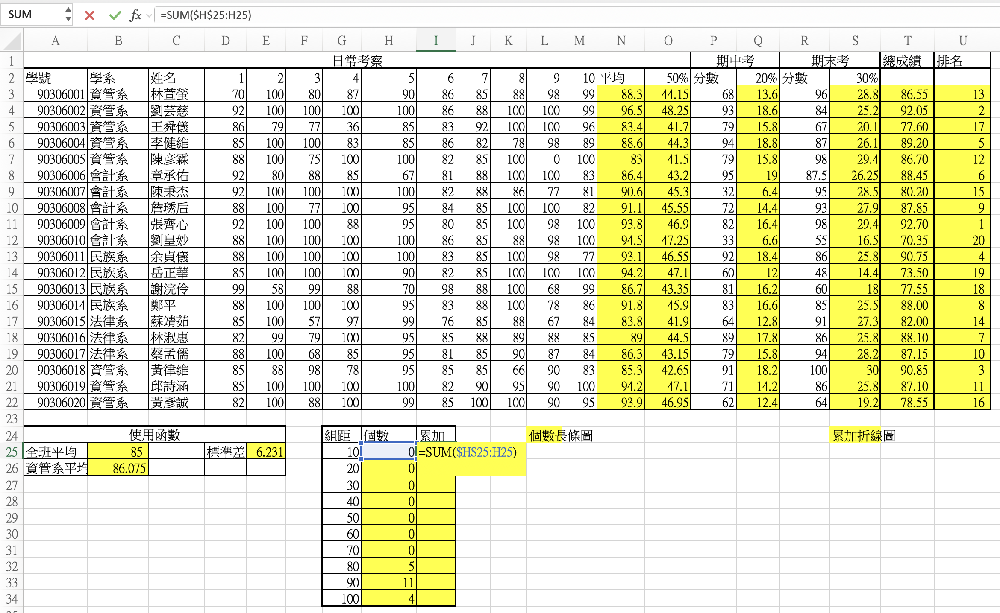

### 步驟 23　I 欄向下填滿

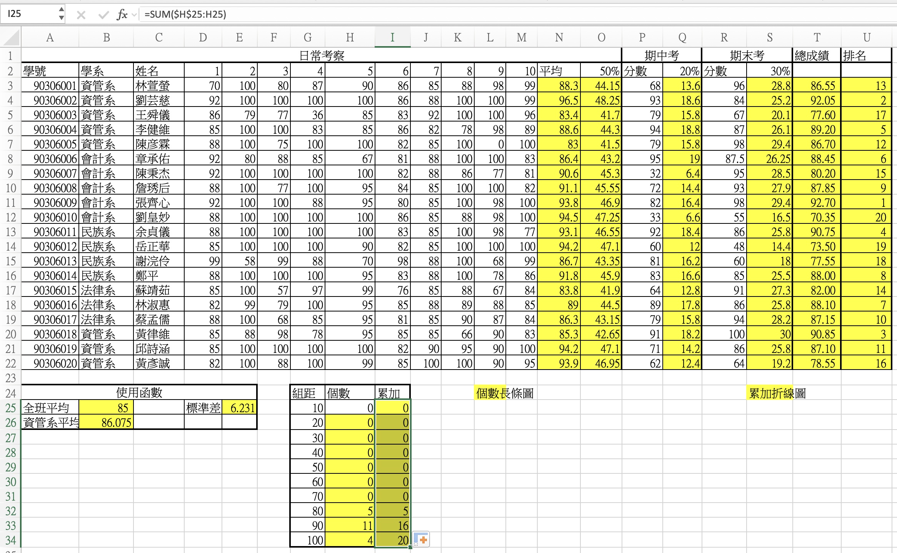

> **驗算**：I34 應該等於 20（全班人數）。

---

## 階段 7：繪製統計圖

### 步驟 24　向 AI 提問：繪製長條圖與折線圖

**Prompt**

```text
我已經完成所有數值填寫，現在要繪製各組距個數的長條圖及累加折線圖，兩張圖的左上角分別放在L25和S25。協助我完成這兩張統計圖的繪製。
```

AI 說明：它只看得到截圖，沒辦法直接在 Excel 檔裡畫圖，所以提供 Excel 內的操作步驟。

**個數長條圖（左上角放 L25）**

1. 選取 H24:H34（「個數」標題加上 10 個數值，不要選到 G 欄）。
2. 「插入」→「直條圖」→「群組直條圖」。
3. 在圖上按右鍵 →「選取資料」→「水平（類別）軸標籤」按「編輯」→ 選取 G25:G34。這樣 X 軸才會顯示 10、20…100，而不是 1～10。
4. 圖表標題改成「總成績個數分布」。
5. 加上座標軸標題：X 軸「組距」、Y 軸「人數」。
6. 想看起來像直方圖：對長條按右鍵 →「資料數列格式」→ 把「間距寬度」調成 0～10%。
7. 拖曳圖表使左上角對齊 L25（按住 Option／Alt 會自動貼齊格線）。

**累加折線圖（左上角放 S25）**

1. 選取 I24:I34。
2. 「插入」→「折線圖」→「折線圖（帶有資料標記）」。
3. 在「選取資料」把水平軸標籤設為 G25:G34。
4. 標題改成「總成績累加次數」，X 軸「組距」，Y 軸「累加人數」。
5. 把圖表左上角拖到 S25。

**位置提醒**：長條圖寬度請控制在 R 欄結束前，避免蓋到 S25 的折線圖；兩張圖高度建議相同。

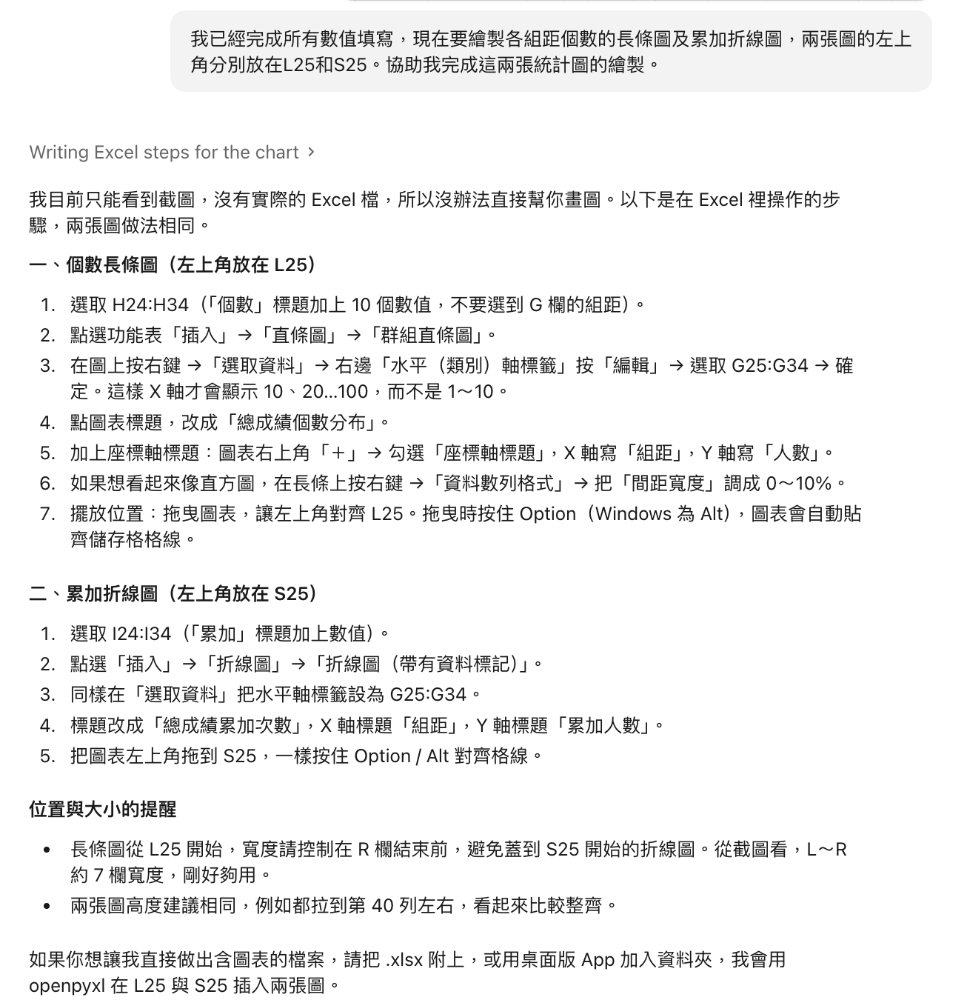

### 步驟 25　完成

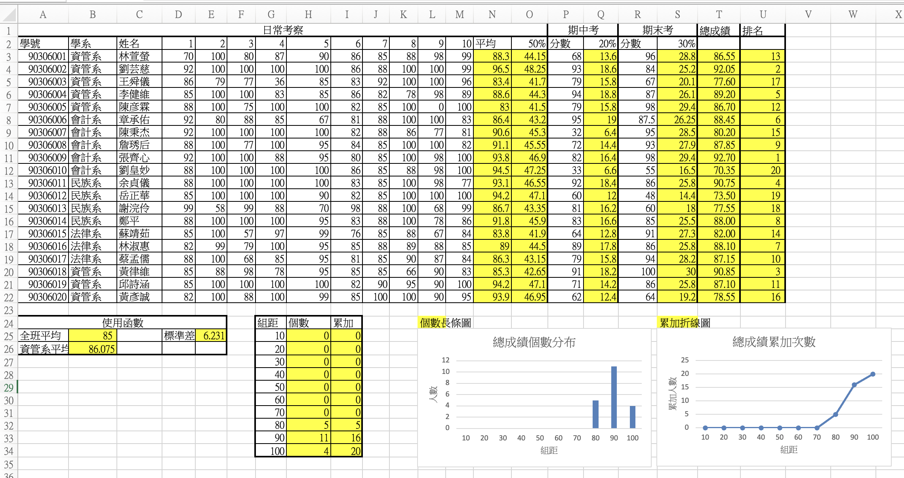

> 最終成果：全班平均 85、標準差 6.231、資管系平均 86.075，並有個數長條圖與累加折線圖。

---

## 本範例用到的函數總表

| 儲存格 | 用途 | 公式 |
|---|---|---|
| N3 | 日常平均 | `=AVERAGE(D3:M3)` |
| O3 | 日常 × 50% | `=N3*0.5` |
| Q3 | 期中 × 20% | `=P3*0.2` |
| S3 | 期末 × 30% | `=R3*0.3` |
| T3 | 總成績 | `=O3+Q3+S3` |
| U3 | 排名 | `=RANK(T3,$T$3:$T$22,0)` |
| B25 | 全班平均 | `=AVERAGE(T3:T22)` |
| F25 | 標準差 | `=STDEV.P(T3:T22)` |
| B26 | 資管系平均 | `=AVERAGEIF(B3:B22,"資管系",T3:T22)` |
| H25:H34 | 各組距個數 | `=COUNTIFS($T$3:$T$22,"<="&G25,$T$3:$T$22,">"&(G25-10))` 或 `=FREQUENCY(T3:T22,G25:G33)` |
| I25:I34 | 累加次數 | `=SUM($H$25:H25)` |
